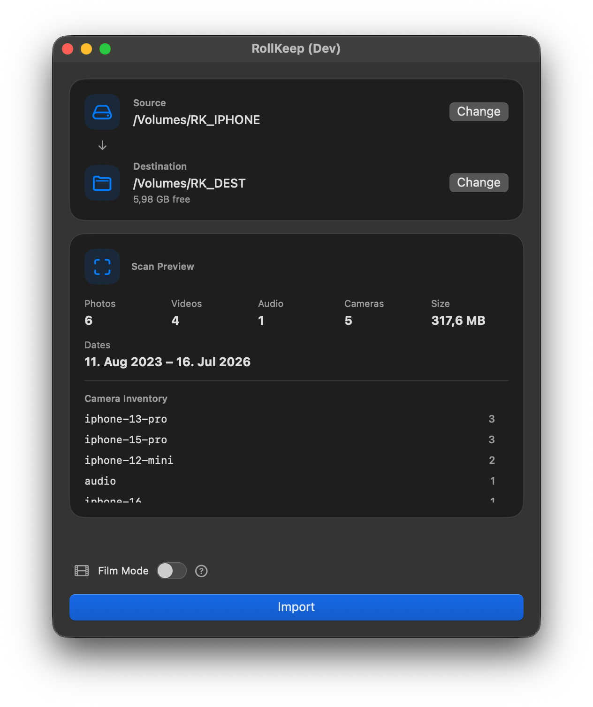
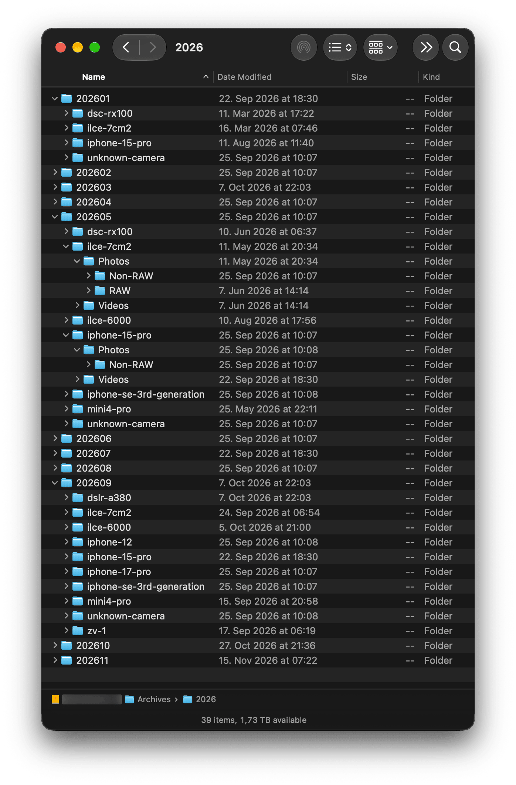

<p align="left">
  
</p>

# Fyluro

Fyluro is a macOS app that copies photos, videos and audio from a camera card to your drive.
It verifies each copy, files each item in a dated folder, and writes a receipt.
The `fyluro` command-line tool runs the same engine for scripts and terminal use.

- **Website:** [fyluro.thanosam.com](https://fyluro.thanosam.com)
- **To use the app:** read the [User Guide](docs/user-guide/README.md).
- **To change the code:** read this file, then `docs/ROL-6-spec-and-invariants.md`.

The app is the main product. The CLI is a complementary interface. It can offer fewer options than the app.

| App | Receipt | Library |
| :---: | :---: | :---: |
|  |  |  |

## How it works

Each run follows the same steps:

1. **Scan** the source and plan the destination paths.
2. **Copy** each file to a staging folder in the destination. Fyluro hashes the bytes (SHA-256) while it copies.
3. **Verify** each staged file. Fyluro reads it back and hashes it again. The hash and the byte count must match.
4. **Commit** each verified file to its final path. Fyluro never overwrites a file in the library.
5. **Write a receipt** (NDJSON) that records what Fyluro scanned, copied, verified, skipped or failed.

The ten invariants (I-1 to I-10) are in Section 3 of the spec. They include:

- Fyluro never changes the source card.
- Fyluro never skips verification.
- A failed run keeps its evidence.

## Requirements

- A Mac with Apple silicon and macOS 13 or later.
- Xcode Command Line Tools (Swift 5.9 or later) to build and run unit tests.
- `python3` and `jq` to run the E2E and smoke test scripts (`jq` ships with macOS 15 or later; install it with Homebrew on macOS 13 and 14).
- Full Xcode 26 or later to package `Fyluro.app` with `scripts/package-macos-app.sh` (`xcrun actool` compiles the Icon Composer `.icon` bundle).

## Install

Install with Homebrew:

```bash
brew install --cask taaanos/tap/fyluro
```

The Homebrew cask removes the macOS quarantine mark automatically.

Or install manually from [GitHub Releases](../../releases) with `Fyluro-<version>-macos-arm64.zip` and its `.sha256` file.

For manual downloads, verify the archive before you open the app:

```bash
shasum -a 256 -c Fyluro-<version>-macos-arm64.zip.sha256
gh attestation verify Fyluro-<version>-macos-arm64.zip --owner Taaanos
```

Manual downloads use ad-hoc signing without an Apple Developer ID, so macOS Gatekeeper blocks the first open.

1. Unpack the `.zip` and move `Fyluro.app` to **Applications**.
2. Follow [Install](docs/user-guide/README.md#2-install) in **System Settings > Privacy & Security**, or run `xattr -cr /Applications/Fyluro.app`.

## Build and run

Run all commands from the repository root.

```bash
swift build                    # debug build of the CLI and the launcher
scripts/run-dev-app.sh         # build a debug Fyluro-dev.app in dist/ and open it
swift run fyluro-launcher    # run the app executable without an app bundle
swift run fyluro --help      # show the CLI help
```

## CLI

```bash
swift run fyluro --source /Volumes/SD --dest /Volumes/Media --dry-run
```

| Option | Purpose |
| --- | --- |
| `--source <path>` | Source folder. If you omit it, Fyluro looks for a card in `/Volumes`. |
| `--dest <path>` | Destination library. If you omit it, Fyluro reuses the last destination that has Fyluro receipts. |
| `--dry-run` | Scan and plan only. Fyluro writes no library files. |
| `--pdf` | Write a PDF summary next to the receipt. |
| `--json` | Print the final summary as JSON. |
| `--verbose` | Print diagnostic logs. |
| `--max-parallel-copies <n>` | Number of files to copy in parallel (default 1). |
| `--detect-timeout-seconds <n>` | Seconds to wait for a card when you omit `--source` (default 60, `0` waits without end). |
| `--pick-source`, `--pick-dest` | Show a folder picker. |

Exit codes: `0` success, `1` other failure, `2` verify, `3` scan, `4` plan, `5` copy, `6` commit, `7` finalize.
The code from `2` to `7` shows the phase that failed.

The CLI always reads your Camera Labels file. The app has a setting for this feature. It is experimental and off by default.

## Where files go

```
<DEST>/YYYY/YYYYMM/<camera>/Photos/<filename>
<DEST>/YYYY/YYYYMM/<camera>/Videos/<filename>
<DEST>/YYYY/YYYYMM/audio/<filename>
<DEST>/_unsorted/...                       (no valid capture date)
<DEST>/_ingest_staging/<SESSION_ID>/...    (temporary; removed after a successful run)
<DEST>/_ingest_receipts/<SESSION_ID>.ndjson
```

The date folder, the camera folder and the RAW split are settings. The full rules are in Section 4 of the spec.
If the destination receipt folder is not writable, Fyluro writes the receipt to `<LOCAL_TMP>/fyluro/_ingest_receipts/`.

## Test

```bash
swift test                                        # run unit tests
python3 scripts/build-e2e-fixtures.py --synthetic # build tiny synthetic source cards
python3 scripts/build-e2e-fixtures.py --check     # verify source cards against manifest
scripts/run-e2e-tests.sh                          # run all e2e scripts
```

Run `swift test` before you commit.
Run `scripts/run-e2e-tests.sh` before you push to `origin/main`.
On a clean clone, `scripts/run-e2e-tests.sh` creates the synthetic source cards automatically if they do not exist.
You can also build real-media cards locally with `--real` (optional for maintainers).
See `Tests/e2e-ingest-matrix.md` for fixture details.

## Package and release

```bash
scripts/package-macos-app.sh --version <version>   # build dist/Fyluro.app, the zip and the .sha256
scripts/release-cut.sh --bump patch                # test, package, update VERSION and CHANGELOG, publish
```

`release-cut.sh` runs `release-prepare.sh` (tests, packaging, packaged-app smoke test) and then `release-publish.sh` (git tag and GitHub Release).
Every script accepts `-h` and prints its usage. Use `--dry-run` or `--no-publish` to stop before you publish.

Before you ship a release that changes launcher startup, source detection or scan-on-launch code, run this step by hand:

```bash
scripts/release-app-smoke-test.sh --with-launcher-check
```

## Source layout

| Folder | Content |
| --- | --- |
| `Sources/FyluroCore` | Scan, metadata, camera labels and file rules. |
| `Sources/FyluroEngine` | The ingest pipeline, receipts and the PDF. The app and the CLI share it. |
| `Sources/fyluro` | The CLI. |
| `Sources/fyluroLauncher` | The macOS app. |
| `Tests`, `scripts` | Unit tests, test fixtures, e2e scripts and release scripts. |

## Security and dependencies

- **Zero network and telemetry:** Fyluro makes no network requests and collects no telemetry.
- **Minimal dependencies:** `FyluroCore` and `FyluroEngine` have zero external dependencies. The CLI uses only `swift-argument-parser` in [Package.swift](Package.swift).
- **Threat model and reporting:** See [Security Policy](SECURITY.md) and [Security Threat Model](docs/security-threat-model.md).

## Documents

| Document | Use |
| --- | --- |
| [User Guide](docs/user-guide/README.md) | How to use the app. |
| [Docs index](docs/README.md) | Map of all documentation folders. |
| [Spec and invariants](docs/ROL-6-spec-and-invariants.md) | The source of truth for product behavior. |
| [Security Policy](SECURITY.md) | How to report security vulnerabilities privately. |
| [Security Threat Model](docs/security-threat-model.md) | Threat-to-invariant and E2E test mapping. |
| [Contributing](CONTRIBUTING.md) | Pull request checklist and rules. |
| [Working rules](AGENTS.md) | Writing rules, the work loop and the Definition of done. |
| [Work index](docs/work/README.md) | Active bugs and stories quick view. |
| [Bugs](docs/work/bugs.md) | Bugs and gaps that we know about. |
| [Stories](docs/work/stories.md) | Planned features and future work. |
| [Decision records](docs/adr) | Why we made key decisions. |
| [CHANGELOG](CHANGELOG.md) | Changes in each release. |

## License

Fyluro is licensed under the GNU General Public License v3.0. See `LICENSE` for the full text.

See [NOTICE](NOTICE) for third-party notices and ExifTool attribution.

Fyluro is distributed via [GitHub Releases](../../releases) rather than the Mac App Store because Mac App Store terms conflict with GPL-3.0.
