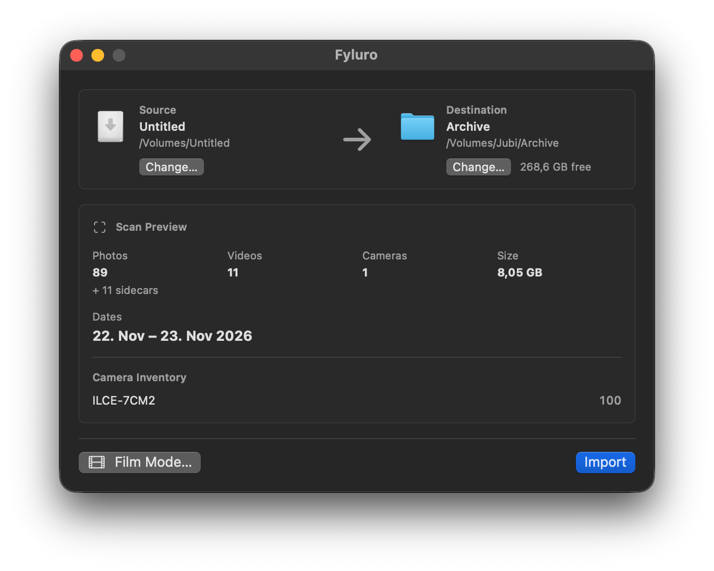

<p align="left">
  
</p>

# Fyluro

Fyluro is a macOS app that copies photos, videos and audio from a camera card to your drive.
It verifies each copy, files each item in a dated folder, and writes a receipt.
The `fyluro` command-line tool runs the same engine for scripts and terminal use.

- **Website:** [fyluro.thanosam.com](https://fyluro.thanosam.com)
- **User documentation:** [fyluro.thanosam.com/docs](https://fyluro.thanosam.com/docs)
- **Product spec:** [ROL-6-spec-and-invariants.md](docs/ROL-6-spec-and-invariants.md)



## Install

Install with Homebrew:

```bash
brew install --cask taaanos/tap/fyluro
```

For manual downloads from [GitHub Releases](../../releases), checksum checks, Gatekeeper steps, and full usage guides, read the [documentation](https://fyluro.thanosam.com/docs).

## Build and test

Requirements: Apple silicon Mac with macOS 13 or later, Xcode Command Line Tools (Swift 5.9 or later), `python3`, `jq`, and Xcode 26 or later to package `.app` bundles.

Run all commands from the repository root:

```bash
swift build                    # debug build of the CLI and launcher
scripts/run-dev-app.sh         # build debug Fyluro-dev.app in dist/ and open it
swift run fyluro --help      # show CLI help
swift test                     # run unit tests
scripts/run-e2e-tests.sh       # run all E2E scripts
```

## Source layout

| Folder | Content |
| --- | --- |
| `Sources/FyluroCore` | Scan, metadata, camera labels and file rules. |
| `Sources/FyluroEngine` | The ingest pipeline, receipts and the PDF. The app and the CLI share it. |
| `Sources/fyluro` | The CLI. |
| `Sources/fyluroLauncher` | The macOS app. |
| `Tests`, `scripts` | Unit tests, test fixtures, e2e scripts and release scripts. |

## Security and dependencies

- **Zero network and telemetry:** Fyluro makes no network requests and collects no telemetry.
- **Minimal dependencies:** `FyluroCore` and `FyluroEngine` have zero external dependencies. The CLI uses only `swift-argument-parser` in [Package.swift](Package.swift).
- **Threat model and reporting:** See [Security Policy](SECURITY.md) and [Security Threat Model](docs/security-threat-model.md).

## Documents

| Document | Use |
| --- | --- |
| [User documentation](https://fyluro.thanosam.com/docs) | How to install and use the app and CLI. |
| [Docs index](docs/README.md) | Map of repository documentation folders. |
| [Spec and invariants](docs/ROL-6-spec-and-invariants.md) | The source of truth for product behavior. |
| [Security Policy](SECURITY.md) | How to report security vulnerabilities privately. |
| [Security Threat Model](docs/security-threat-model.md) | Threat-to-invariant and E2E test mapping. |
| [Contributing](CONTRIBUTING.md) | Pull request checklist and rules. |
| [Working rules](AGENTS.md) | Writing rules, the work loop and the Definition of done. |
| [Work index](docs/work/README.md) | Active bugs and stories quick view. |
| [Decision records](docs/adr) | Why we made key decisions. |
| [CHANGELOG](CHANGELOG.md) | Changes in each release. |

## License

Fyluro is licensed under the GNU General Public License v3.0. See [LICENSE](LICENSE) for the full text.
See [NOTICE](NOTICE) for third-party notices and ExifTool attribution.
Fyluro is distributed via [GitHub Releases](../../releases) rather than the Mac App Store because Mac App Store terms conflict with GPL-3.0.
