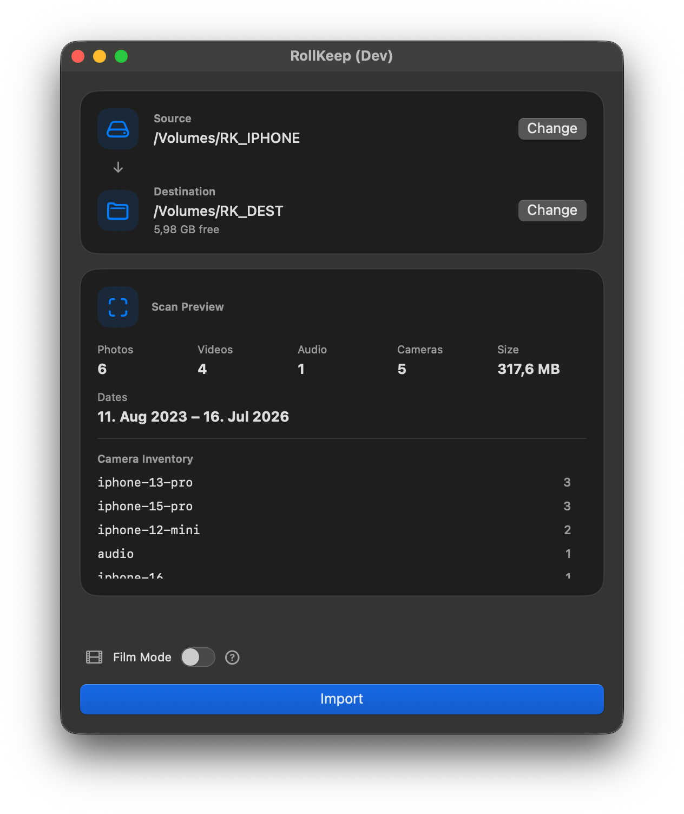
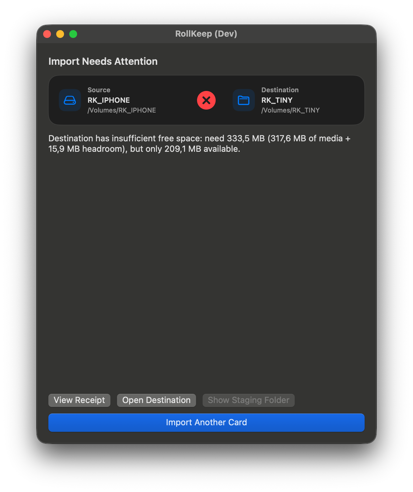
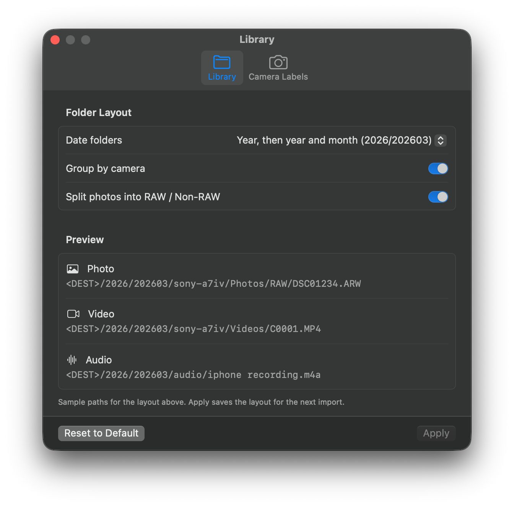
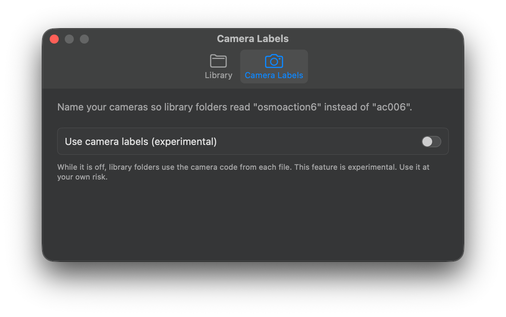
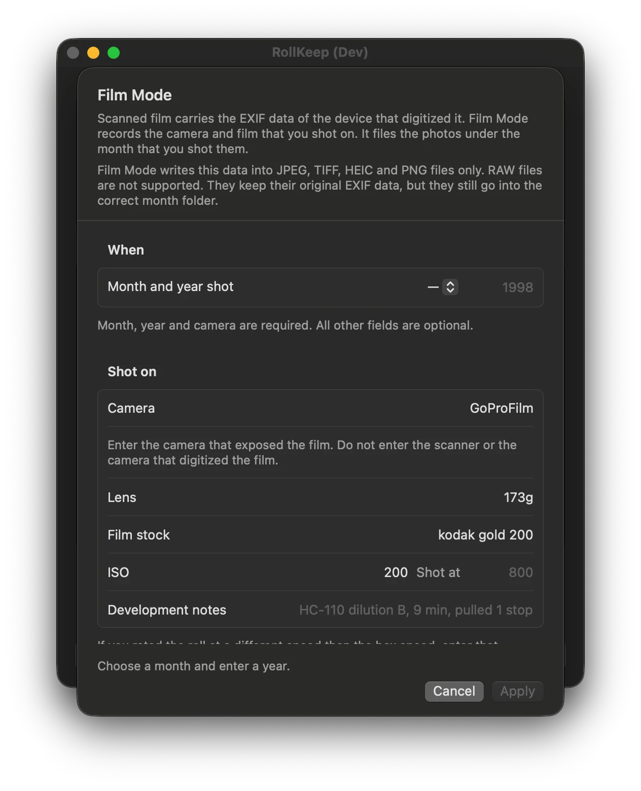

# RollKeep User Guide

<!--
Maintainer note. This guide describes behavior that the product spec defines.
Spec: docs/ROL-6-spec-and-invariants.md (Sections 2 to 11). Known gaps: docs/known-issues.md.
Button and label words come from Sources/rollkeepLauncher. Change this guide in the same commit as a change in behavior.
Write in ASD-STE100 (docs/working-style.md).
-->

RollKeep copies photos, videos and audio from a camera card to your drive.
It verifies each copy. It puts each file in a dated folder. It writes a receipt of the work.

This guide shows how to use the RollKeep app on a Mac.

## Contents

1. [Quick start](#1-quick-start)
2. [Install](#2-install)
3. [The main window](#3-the-main-window)
4. [During an import](#4-during-an-import)
5. [After an import](#5-after-an-import)
6. [Where your files go](#6-where-your-files-go)
7. [Settings](#7-settings)
8. [Film Mode](#8-film-mode)
9. [Supported files](#9-supported-files)
10. [How RollKeep keeps your files safe](#10-how-rollkeep-keeps-your-files-safe)
11. [Before you erase a card](#11-before-you-erase-a-card)
12. [Troubleshooting](#12-troubleshooting)
13. [Glossary](#13-glossary)

## 1. Quick start

1. Put the card in your Mac.
2. Open RollKeep.
3. Look at **Source** and **Destination**. Click **Change** to choose a different folder.
4. Wait for **Scan Preview** to show the counts.
5. Click **Import**.
6. Wait for **Import Complete**.
7. Click **Open New Folders in Finder** to see your files.

RollKeep does not change or erase your card. You decide when to erase it.
Read [Before you erase a card](#11-before-you-erase-a-card) first.

## 2. Install

### What you need

- A Mac with Apple silicon.
- macOS 13 (Ventura) or later.
- A destination drive that your Mac can write to, with enough free space for your files.

### Steps

1. Download `RollKeep-<version>-macos-arm64.zip`.
2. Double-click the zip file. Finder unpacks `RollKeep.app`.
3. Drag `RollKeep.app` into the **Applications** folder.
4. Open `RollKeep.app`. macOS shows a message that it cannot verify the app. Close the message.
5. Open **System Settings**. Click **Privacy & Security**. Scroll down to **Security**.
6. Click **Open Anyway** next to the message about RollKeep. Enter your password if macOS asks.
7. Open `RollKeep.app` again. Click **Open** if macOS asks.

RollKeep does not have an Apple Developer ID signature. For this reason, macOS blocks the first open.
You do these steps one time only.

The first time that RollKeep reads a card, macOS can ask for access to a removable volume. Click **Allow**.

### Verify your download (optional)

Each release has a `.sha256` file. Put it in the same folder as the zip file. Run this command in that folder:

```bash
shasum -a 256 -c RollKeep-<version>-macos-arm64.zip.sha256
```

The command prints `OK` when the zip file is complete and unchanged.

## 3. The main window



| Part | What it does |
| --- | --- |
| **Source** | The folder that you import from. Usually this is your card. |
| **Destination** | The folder where RollKeep builds your library. It shows the free space. |
| **Scan Preview** | What RollKeep found in the source. |
| **Film Mode** | A switch for film scans. See [Film Mode](#8-film-mode). |
| **Import** | Starts the import. It stays dimmed until the scan ends and both folders are valid. |

### Choose the source

Use one of these ways:

- **Let RollKeep choose.** When RollKeep opens, it looks for a mounted volume with a `DCIM` folder, or a volume that macOS marks as removable. It picks the best match.
- **Click Choose or Change.** Choose a folder in the dialog. Click **Use Source**.
- **Drag a folder from Finder onto the window.** If you drag a file, RollKeep uses the folder that holds the file.

RollKeep looks for a card when it opens and when you click **Import Another Card**.
It does not look again when you put in a card later. In that case, click **Change** and choose the card.

The source can be any folder. RollKeep reads all subfolders in it.

### Choose the destination

1. Click **Change** in the **Destination** row.
2. Choose a folder on your drive in the dialog.
3. Click **Use Destination**.

RollKeep remembers your choice for the next time. If you never chose a destination, RollKeep picks the volume with the newest RollKeep receipts.

The destination must be a folder that your Mac can write to.
The source and the destination must be different folders. One cannot be inside the other.

RollKeep shows the free space of the destination under its path.

### Read Scan Preview

When you choose a source, RollKeep scans it. The scan only reads files. It copies nothing.

| Item | Meaning |
| --- | --- |
| **Photos**, **Videos**, **Audio** | The number of files of each kind. **Audio** shows only when RollKeep finds audio files. |
| **Cameras** | The number of different cameras that RollKeep found. |
| **Size** | The total size of the media that RollKeep found. |
| **Dates** | The first and the last capture date. |
| **Camera Inventory** | One row for each camera folder that RollKeep will make, with the number of files for it. |

In **Camera Inventory**:

- A name such as `iphone-15-pro` is the name of the camera folder. See [Camera folders](#camera-folders).
- `unknown-camera` is for files that have no camera information.
- `audio` is for audio files. Audio files do not get a camera folder.

Read the notices under the counts. They tell you about files that RollKeep will skip or place in a special folder:

| Notice | Meaning |
| --- | --- |
| `N files couldn't be read and will be skipped.` | RollKeep cannot read these files. They are not imported. |
| `N files will be skipped (large or unsupported files).` | RollKeep skips symbolic links. It also skips large files with an unknown file type. |
| `N items will be placed in _unsorted because capture date metadata is missing.` | RollKeep cannot find a date for these files. See [Files without a date](#files-without-a-date). |

If RollKeep finds no files, **Scan Preview** says **No media found.**

### Start the import

Click **Import**. You can also press Return.

## 4. During an import

The window shows the source and the destination, a progress bar, and the work in progress.
The bottom right corner shows the phase.

| Phase | What RollKeep does |
| --- | --- |
| Scanning source media | Reads the source and lists the files. |
| Planning destination layout | Decides the folder for each file. |
| Creating verified copy | Copies each file to a staging folder on the destination. |
| Verifying copied files | Reads each copy back and compares it with the original. |
| Saving files to library | Moves the verified files into your library. |
| Finalizing receipt | Writes the receipt and the PDF summary. |

Keep the card and the destination drive connected until the import ends.

### Stop an import

Click **Stop Import**. RollKeep stops at the next safe point.

- Files that RollKeep already added to the library stay there.
- RollKeep deletes nothing.
- RollKeep keeps the receipt and the staging folder.

A stop during the first scan can take some time. RollKeep must finish the scan first.

## 5. After an import

### Import Complete


The headline tells you how many items RollKeep imported. The second line tells you about duplicates, or it says that new files were added.
If you import a card again, the headline says that no new items were imported. This is normal. See [Duplicates and renames](#duplicates-and-renames).

| Count | Meaning |
| --- | --- |
| **Added to library** | Files that RollKeep added to your library. This count includes sidecar files. It can be more than Photos + Videos + Audio. |
| **Already in library** | Files that were already in your library. RollKeep did not copy them again. |
| **Size** | The total size of the media that RollKeep found. |
| **Photos**, **Videos**, **Audio** | The number of files of each kind. A kind with zero files is hidden. |
| **Cameras** | The number of different cameras that RollKeep found. |
| **Renamed** | Files that got a number suffix, because a different file had the same name. It shows only when the count is more than zero. |
| **Elapsed** | The time that the import took. |

**Receipt saved** means that RollKeep wrote the receipt.

The buttons:

| Button | What it does |
| --- | --- |
| **Open New Folders in Finder** | Opens the new `Photos` and `Videos` folders that this import made. It shows only when the import made new folders. |
| **View Receipt** | Selects the receipt in Finder. Double-click the PDF to open it. |
| **Open Source** | Selects the source folder in Finder. |
| **Import Another Card** | Resets the window for the next card. Film Mode switches off. |

If no new folders exist, **Import Another Card** becomes the main button.

#### The orange notice

An orange notice that says `N files could not be copied` lists files that RollKeep could not read or copy.
Each file has a message. These files are not in your library. They stay on your card.
Open the receipt for details.

### Import Needs Attention



The import did not finish. The message tells you why.
Read [Troubleshooting](#12-troubleshooting) for common messages.

After a failure:

- RollKeep keeps the receipt and the staging folder.
- Files that RollKeep already added to the library stay there.
- Your card is not changed.

| Button | What it does |
| --- | --- |
| **View Receipt** | Selects the receipt in Finder. |
| **Open Destination** | Selects the destination folder in Finder. |
| **Show Staging Folder** | Selects the staging folder in Finder. It is dimmed when no staging folder exists. |
| **Import Another Card** | Resets the window. |

To try again, fix the cause. Then click **Import Another Card**, and click **Import**.
RollKeep copies and verifies all files again. Files that are already in your library show as **Already in library**.

### Import Stopped

This screen shows when you click **Stop Import**. It is not an error. The mark is gray.
It has the same buttons and the same rules as **Import Needs Attention**.

### Staging folders

During an import, RollKeep copies files to `_ingest_staging/<session>` inside your destination.
After a successful import, RollKeep removes this folder.
After a failure or a stop, RollKeep keeps it. RollKeep never removes an old staging folder.
You can delete an old staging folder in Finder when you no longer need it.

### The receipt

Each import writes two files in the `_ingest_receipts` folder of your destination:

| File | Use |
| --- | --- |
| `<session>.summary.pdf` | The PDF summary. It is for people. **View Receipt** selects this file. |
| `<session>.ndjson` | The full event log. It has one JSON event on each line. It is for tools and for support. |

The PDF has these sections:

| Section | Content |
| --- | --- |
| Header | The status (**VERIFIED** or **FAILED**), the date, the session, the source, the destination and the folder layout. |
| Film Mode | The film camera and film that you recorded. It shows only when you used Film Mode. |
| Attention | The reason for a failed import. |
| At a Glance | **Found**, **Verified**, **Added to library**, **Already in library**, **Renamed**, **Errors** and **Data**. |
| Needs a look | Errors and files that did not finish. |
| Renamed to avoid overwrite | Each file that got a suffix. It shows the name on the card and the name in the library. |
| Capture Inventory | The number of files with and without camera information, and the date range. |
| Where files landed | The number of files in each library folder. |

**VERIFIED** means that every file that RollKeep copied passed verification.
It does not mean that RollKeep copied every file on the card.
RollKeep skips some files. Read **Errors** and **Needs a look** to see them.

## 6. Where your files go

RollKeep builds your library in the destination folder. These are the default folders:

```text
<Destination>/
  2026/
    202603/
      iphone-15-pro/
        Photos/IMG_0001.HEIC
        Videos/IMG_0002.MOV
      audio/
        recording.m4a
  _ingest_receipts/
  _ingest_staging/      (only after a failed or stopped import)
```

| Folder | Content |
| --- | --- |
| `2026/202603` | The year and the month of the capture date. |
| `iphone-15-pro` | The camera folder. |
| `Photos`, `Videos` | The kind of media. |
| `audio` | All audio files for that month. Audio has no camera folder. |
| `_ingest_receipts` | The receipts. |
| `_ingest_staging` | The staging folders. RollKeep removes them after a successful import. |

You can change the date folders and the camera folder in [Settings](#7-settings).
You can also split photos into `RAW` and `Non-RAW` folders.

### Camera folders

RollKeep reads the camera model from the metadata of each file. It makes the folder name from the model.
The name has lowercase letters, numbers and dashes only. For example, `iPhone 15 Pro` becomes `iphone-15-pro`.

- A card can have many cameras. RollKeep makes one folder for each camera.
- A file without camera information goes in `unknown-camera`.
- Some cameras write a code and not a name, for example `ac006`. The folder then has that code. See [Camera Labels](#camera-labels-experimental).

### File names

RollKeep does not rename your files. A file has the same name in the library as on the card.
The only change is a number suffix, as described in the next section.

### Duplicates and renames

RollKeep never overwrites a file in your library. When a file with the same folder and name exists:

- **Same content.** RollKeep sees a duplicate. It does not copy the file again. The file counts as **Already in library**.
- **Different content.** RollKeep keeps both files. It adds `-1`, `-2` and so on to the name of the new file, before the extension. The file counts as **Renamed**.

RollKeep finds a duplicate only in the folder where the file would go.
If you change the folder layout in [Settings](#7-settings), RollKeep copies a card that you already imported again, to the new folders.

### Sidecar files

A sidecar is a small file that belongs to a photo or a video, for example an `.XMP` or a `.THM` file.
RollKeep copies a sidecar with its photo or video. It puts the sidecar in the same folder.
RollKeep verifies sidecars in the same way as photos and videos.

A `.WAV` file that has the same name as a video in the same folder is a sidecar of that video. Other `.WAV` files are audio.

### Dates

RollKeep puts a file in a folder for the month in which it was captured. It reads the capture date in this order:

| Kind | Order |
| --- | --- |
| Photos | The date that the camera wrote in the photo, then the date that the file was last changed on the card. |
| Videos | The creation date in the video, then the date in a sidecar file, then the date that the file was last changed on the card. |
| Audio | The creation date in the audio file, then the date that the file was last changed on the card. |

If a date has no time zone, RollKeep uses the time zone of your Mac.
If the clock of your camera was wrong, the folder date is wrong too.

RollKeep keeps the modified date of each file. It keeps the created date when the destination drive allows it.

#### Files without a date

RollKeep uses the `_unsorted` folder only when it cannot find any date for a file. This is rare.
The folder layout is the same, with `_unsorted` in place of the year and month.

## 7. Settings

Open the settings. Click **RollKeep** in the menu bar, then click **Settings…**. You can also press Command-comma.
The settings have two tabs: **Library** and **Camera Labels**.

### Library



In this picture, the **Split photos into RAW / Non-RAW** switch is on. The default is off.

| Setting | Default | What it does |
| --- | --- | --- |
| **Date folders** | Year, then year and month (2026/202603) | Chooses the date folders. The other choice is Year, then month (2026/03). |
| **Group by camera** | On | Puts files in a folder for each camera. |
| **Split photos into RAW / Non-RAW** | Off | Puts RAW photos in a `RAW` folder and other photos in a `Non-RAW` folder. |

The **Preview** group shows a sample path for a photo, a video and an audio file. It changes when you change a setting.

- Click **Apply** to save the layout. It applies to the next import. **Apply** is dimmed until you make a change.
- Click **Reset to Default** to set the three options back to their default values. Then click **Apply** to save them.

A running import keeps the settings that it started with.

Choose a layout before your first import, and keep it. Old folders stay as they are when you change the layout.

### Camera Labels (experimental)



Some cameras write a code and not a name in their files. Camera Labels lets you give each code a name of your own.
For example, the folder can read `osmoaction6` and not `ac006`.

This feature is experimental. It is off by default. Use it at your own risk.

To name a camera:

1. Open **Settings** and click **Camera Labels**.
2. Turn on **Use camera labels (experimental)**.
3. Find the camera in **On the Current Card**. Type a name next to its code. Press Return.
4. To add a camera that is not on the card, type its code and a name in **Your Labels**. Click **Add**.

RollKeep saves each name at once. The **Folder** column shows the folder name that the name makes.
To remove a label, click the trash icon in its row.

- You can give the same name to more than one code. They then share one folder. RollKeep shows the note `Same folder as …`.
- A new label applies to the next import. Folders that exist stay as they are.
- RollKeep keeps your labels in `~/Library/Application Support/RollKeep/CameraCatalog.json`.
- When the switch is off, RollKeep ignores your labels. It does not delete them.

## 8. Film Mode

A scan of film carries the metadata of the scanner or camera that digitized it.
Film Mode records the camera and the film that you shot on. It also files the photos under the month that you shot them.

### Turn on Film Mode

1. Click the **Film Mode** switch above the **Import** button. The **Film Mode** sheet opens.
2. Choose the month and enter the year. Enter the camera.
3. Fill in the other fields if you want to.
4. Click **Apply**.



**Apply** stays dimmed until the month, the year and the camera are valid. The text under the form tells you what is missing.

| Field | Required | What to enter |
| --- | --- | --- |
| **Month and year shot** | Yes | The month and the year that you shot the roll. The year has four digits, from 1826 to the current year. |
| **Camera** | Yes | The camera that exposed the film. Do not enter the scanner. |
| **Lens** | No | The lens, for example `50mm f/1.8`. |
| **Film stock** | No | The film, for example `Kodak Gold 200`. |
| **ISO** | No | The speed of the film. Use a whole number above 0. |
| **Shot at** | No | The speed at which you rated the roll. Use it for a pushed roll or a pulled roll. |
| **Development notes** | No | Notes about the development. |
| **Scanner or camera** | No | The device that scanned or photographed the film. |
| **Creator** | No | Your name. |
| **Copyright** | No | The copyright text. |

After you click **Apply**, a line under the switch shows what you recorded.
For example: `Film Mode — shot on Pentax K1000 · Kodak Gold 200 · Sep 1998`.
Click **Edit…** to change it. Turn off the switch to turn off Film Mode.
If you click **Cancel** on a new roll, Film Mode stays off.

The sheet fills **Camera**, **Lens**, **Film stock**, **ISO**, **Scanner or camera**, **Creator** and **Copyright** from your last roll.
It never fills the month, the year, **Shot at** or **Development notes**. A **Recent cameras** menu shows your last cameras.

### What Film Mode changes

- **Folder.** RollKeep files every photo under the month and year that you entered. The camera folder uses the camera that you entered, for example `1998/199809/pentax-k1000/Photos`.
- **Metadata.** RollKeep writes the date, the camera and your other fields into the library copy of each JPEG, TIFF, HEIC and PNG photo.
- **RAW files.** RollKeep cannot write metadata into RAW files. They keep their original metadata. They still go in the correct month folder. The **Import Complete** screen shows how many RAW files kept their metadata.
- **Photos only.** Film Mode does not change videos or audio.
- **Your card.** The files on the card do not change. The file dates do not change.
- **Creator and Copyright.** If you leave them blank, the photo keeps the value that its source file has. RollKeep does not clear it.

RollKeep writes the metadata after it verifies the copy. It does not verify the file again after the write.

Film Mode applies to every photo in the import. Import one roll at a time.
Film Mode is off when you open RollKeep. It also switches off when you click **Import Another Card**.

If you import the same film file again with Film Mode, RollKeep does not see a duplicate.
It keeps both files. The new file gets a number suffix. Import each roll one time.

## 9. Supported files

RollKeep reads the file type from the end of the file name. Upper case and lower case are the same.

| Kind | File types |
| --- | --- |
| Photos | JPG, JPEG, PNG, TIF, TIFF, HEIC, HEIF, GIF, BMP, JXL |
| RAW photos | DNG, CR2, CR3, CRW, NEF, NRW, ARW, SR2, SRF, ORF, ORI, RAF, RW2, SRW, PEF, X3F, IIQ, GPR, MRW, 3FR, FFF, MOS, MEF, DCR, KDC, K25, ERF, RWL |
| Videos | MOV, MP4, M4V, AVI, MPG, MPEG, MTS, M2TS, MXF, 3GP, 3G2, LRV, MKV, INSV, R3D, BRAW, CRM, ARI, CINE, TS, WEBM |
| Audio | WAV, MP3, M4A, AAC, CAF, AIF, AIFF |
| Sidecars | THM, XMP, AAE, XML, SRT, CPI, NKSC, DOP, PP3, JSON, and WAV next to a video with the same name |

RollKeep imports a sidecar only when it belongs to a photo or a video.

RollKeep skips these items:

- Hidden files and folders. Their names start with a dot.
- System folders: `.Trashes`, `System Volume Information`, `$RECYCLE.BIN` and `__MACOSX`.
- Symbolic links. RollKeep never follows them.
- Files with a file type that is not in the table.

RollKeep also looks for large files of an unknown type. A large file is 64 MiB or more.
If such a file is in a folder that cameras use, **Scan Preview** shows a notice. This helps you find media from a new camera.
These folders are `DCIM`, `PRIVATE`, `AVCHD`, `MP_ROOT`, `MISC`, `MOVIE` and `VIDEO`.

## 10. How RollKeep keeps your files safe

RollKeep follows these rules on every import. No setting turns them off.

1. **Your card does not change.** RollKeep only reads the card. It never writes, renames or deletes a file on it.
2. **Your library is never overwritten.** A new file with the same name gets a number suffix.
3. **Every file goes to staging first.** RollKeep adds a file to your library only after the file passes verification.
4. **Verification always runs.** You cannot turn it off or skip it.
5. **Your metadata does not change.** RollKeep does not rewrite the photo or video metadata. The only exception is [Film Mode](#8-film-mode).
6. **A receipt is always written.** If RollKeep cannot write it in the destination, it writes it in a temporary folder on your Mac. If it cannot write it anywhere, the import does not start.
7. **A failed import keeps its evidence.** RollKeep keeps the receipt and the staging folder.
8. **File dates stay.** RollKeep keeps the modified date of each file.
9. **RollKeep writes only in safe places.** It writes the staging folder, the receipts and the new library files in the destination. It can also write a receipt in a temporary folder on your Mac. It deletes only its own staging folder, after a successful import.

### How verification works

1. While RollKeep copies a file to staging, it calculates a SHA-256 hash of the file. A hash is a short code that is unique to the content of the file.
2. After the copy, RollKeep reads the staged file again and calculates the hash again.
3. RollKeep compares both hashes and the file sizes. They must match.

RollKeep copies and verifies all files before it adds the first file to your library.
If one file fails verification, RollKeep stops. It adds no file to your library.

RollKeep verifies the copy in the staging folder. It does not read the file again after it moves the file into your library.

## 11. Before you erase a card

RollKeep never erases a card. You decide when to do it. Before you erase the card:

1. Look for **Import Complete**. Do not erase the card after **Import Needs Attention** or **Import Stopped**.
2. Look for the orange notice. If it shows, those files are not in your library.
3. Read the notices that **Scan Preview** showed. RollKeep skips unreadable files, symbolic links and large files of an unknown type. These files stay on the card only.
4. Open the receipt. Look for **VERIFIED** and for **Errors** with the count 0.
5. Open a few files in your library and look at them.

## 12. Troubleshooting

### RollKeep does not show my card

- You put in the card after RollKeep opened. Click **Change** and choose the card.
- The card has no `DCIM` folder, and macOS does not mark it as removable. Click **Change** and choose the card.

### Source must be a readable folder.

RollKeep cannot read the source. Choose the folder again.
If the problem stays, open **System Settings**, then **Privacy & Security**, then **Files & Folders**. Make sure that RollKeep can use removable volumes.

### Destination must be a writable folder.

Your Mac cannot write to the destination. A drive in the NTFS format is read-only on a Mac. Use a drive in the APFS or exFAT format, or choose another folder.

### Source and destination must be different folders with no nesting.

The source and the destination are the same folder, or one is inside the other. Choose different folders.

### No media found.

RollKeep found no supported files. Make sure that you chose the folder with the media, for example the card itself. See [Supported files](#9-supported-files).

### The Import button is dimmed

The button works only when:

- The scan has ended.
- The source is a readable folder.
- The destination is a writable folder.
- The source and the destination do not overlap.
- The destination has enough free space, or you clicked **Import Anyway**.

When a folder is not valid, a message under the button tells you why.

### Destination has insufficient free space

RollKeep needs the size of the media plus a small extra amount. Free some space, or choose another destination.
The red notice under **Destination** has an **Import Anyway** button. If you click it, the import starts.
The import stops with an error if the drive becomes full.

### A drive disconnected or became full during the import

The **Import Needs Attention** screen names the phase and the file. RollKeep keeps the receipt and the staging folder.
Connect the drive again, or free some space. Then import again.

### A folder has a camera code and not a name

The camera writes a code in its files. See [Camera Labels](#camera-labels-experimental).

### Photos are in the wrong month

RollKeep uses the date in the file. The clock of the camera can be wrong.
For film scans, use [Film Mode](#8-film-mode).

### The import says that no new items were imported

You imported this card before. RollKeep found all files in your library. This is normal.

### Stop Import is slow

A stop during the first scan waits for the scan to end. A stop during the copy is fast.

### Read-back verification failed: hash mismatch

The copy is not the same as the original. The receipt shows the file name. RollKeep added no file to your library.
Try a different card reader, cable or port. Then import again. If the problem stays, the card or the file can be damaged.

### An old `_ingest_staging` folder is in my destination

An import failed or stopped. RollKeep keeps the folder as evidence. You can delete it in Finder when you no longer need it.

### Film Mode photos in RAW still show the scanner

RollKeep cannot write metadata into RAW files. See [Film Mode](#8-film-mode).

## 13. Glossary

| Term | Meaning |
| --- | --- |
| Source | The folder that you import from. Usually a card. |
| Destination | The folder where RollKeep builds your library. |
| Library | The folders and files that RollKeep adds to the destination. |
| Staging folder | A temporary folder in the destination. RollKeep copies each file there first. |
| Verify | To read a copy back and compare it with the original. |
| Receipt | The record of an import. It is a PDF and a log file. |
| Sidecar | A small file that belongs to a photo or a video. |
| Duplicate | A file that is already in the library, with the same content. |
| Capture date | The date that the camera wrote in the file. |
| Camera label | A name that you give to a camera code. |
