# Fyluro User Guide

<!--
Maintainer note. This guide describes behavior that the product spec defines.
Spec: docs/ROL-6-spec-and-invariants.md (Sections 2 to 11). Known gaps: docs/work/bugs.md.
Button and label words come from Sources/fyluroLauncher. Change this guide in the same commit as a change in behavior.
Write in ASD-STE100 (AGENTS.md). The reader knows macOS, Finder and basic file formats.
-->

Fyluro copies photos, videos and audio from a camera card to your drive.
It verifies each copy, files each item in a dated folder, and writes a receipt.

## Contents

1. [Quick start](#1-quick-start)
2. [Install](#2-install)
3. [The main window](#3-the-main-window)
4. [During an import](#4-during-an-import)
5. [After an import](#5-after-an-import)
6. [Where your files go](#6-where-your-files-go)
7. [Settings](#7-settings)
8. [Film Mode](#8-film-mode)
9. [Supported files](#9-supported-files)
10. [How Fyluro keeps your files safe](#10-how-fyluro-keeps-your-files-safe)
11. [Before you erase a card](#11-before-you-erase-a-card)
12. [Troubleshooting](#12-troubleshooting)

## 1. Quick start

1. Put the card in your Mac.
2. Open Fyluro.
3. Click **Choose…** on **Source** and **Destination** to select your folders.
4. Wait for **Scan Preview** to show the counts.
5. Click **Import**.
6. Wait for **Import Complete**.
7. Click **Show in Finder** to see your files.

Fyluro does not change or erase your card. Read [Before you erase a card](#11-before-you-erase-a-card) first.

## 2. Install

Fyluro needs a Mac with Apple silicon and macOS 13 (Ventura) or later.

1. Download `Fyluro-<version>-macos-arm64.zip` and unpack it.
2. Drag `Fyluro.app` into the **Applications** folder.
3. Open `Fyluro.app`. macOS shows a message that it cannot verify the app. Close the message.
4. Open **System Settings**, then **Privacy & Security**. Scroll down to **Security**.
5. Click **Open Anyway** next to the message about Fyluro. Enter your password if macOS asks.
6. Open `Fyluro.app` again. Click **Open** if macOS asks.

Fyluro does not have an Apple Developer ID signature. For this reason, macOS blocks the first open.
You do these steps one time only.

Fyluro runs inside the macOS App Sandbox. Selecting a folder in the **Choose** dialog grants file access for that folder.
Each release has a `.sha256` file. Use `shasum -a 256 -c` to verify the download.

## 3. The main window

| Before you choose a source | After Scan Preview finishes |
| --- | --- |
| 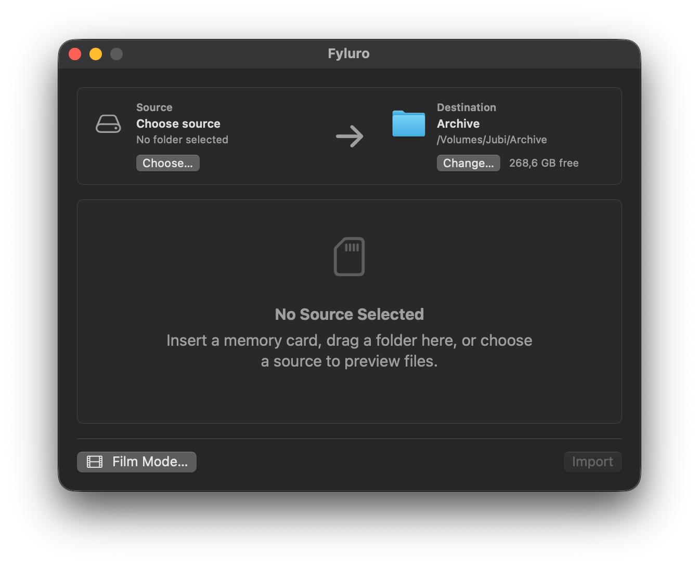 |  |

### Source

- **Choose… or Change…** Choose a folder in the dialog. Click **Use Source**.
- **Drag and drop.** Drag a folder from Finder onto the window. Fyluro rejects single-file drops.

Fyluro stays idle on launch until you choose a source folder.
The source can be any folder. Fyluro reads all subfolders.

### Destination

Click **Choose…** or **Change…**, pick a folder, and click **Use Destination**.
Fyluro saves a security-scoped bookmark for the destination folder across restarts.
After you update `Fyluro.app`, pick the destination folder once again because ad-hoc signing changes the app signature.
The row shows the free space.

The destination must be writable. The source and the destination must be different folders, with no nesting.

### Scan Preview

The scan only reads files. It copies nothing.
It shows the counts of photos, videos and audio, the number of cameras, the total size and the date range.
If Fyluro finds no supported media, it shows **No Supported Media Found** and keeps **Import** dimmed.

**Camera Inventory** has one row for each camera folder that Fyluro will make, with a file count.
`Unknown camera` is for files that have no camera information (they go in `unknown-camera`). `audio` is for audio files.

Read the notices under the counts:

| Notice | Meaning |
| --- | --- |
| `N files couldn't be read and will be skipped.` | Fyluro cannot read these files. They are not imported. |
| `N files will be skipped (large or unsupported files).` | Fyluro skips symbolic links. It also skips large files of an unknown type. |
| `N items will be placed in _unsorted because capture date metadata is missing.` | Fyluro found no date for these files. See [Dates](#dates). |

<details>
<summary>See examples: empty folder and unreadable files</summary>

| No supported media | Unreadable files notice |
| --- | --- |
| 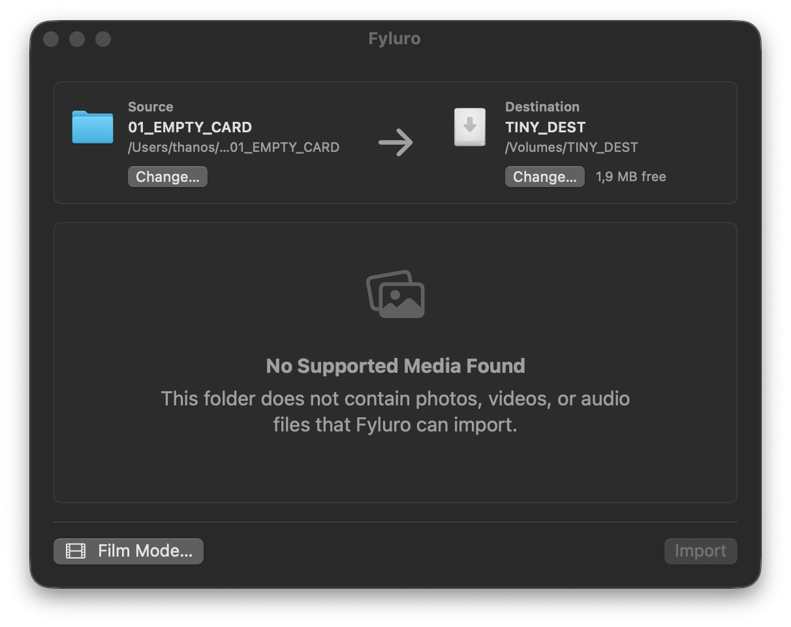 | 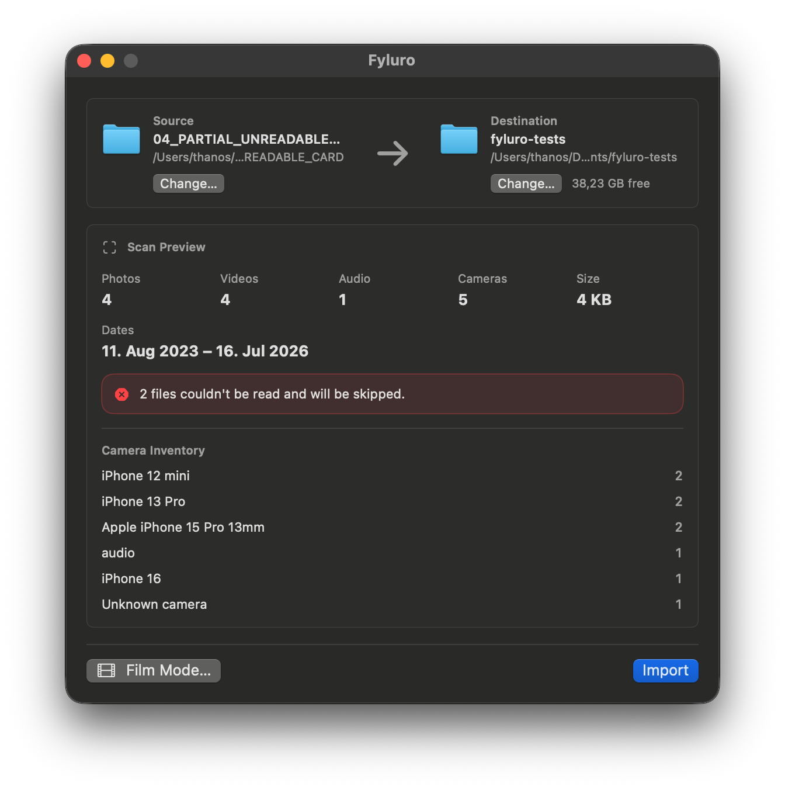 |

</details>

**Import** stays dimmed until the scan ends and both folders are valid. Press Return to start the import.

## 4. During an import

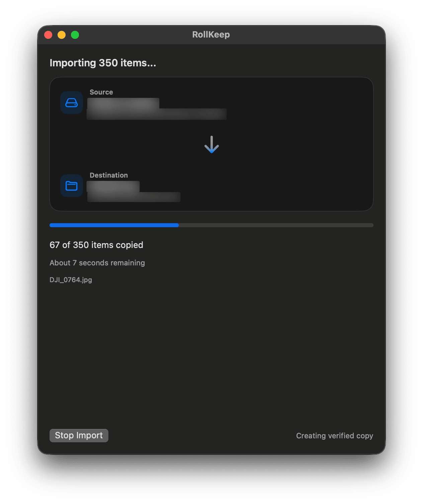

The bottom left corner shows the phase:

| Phase | What Fyluro does |
| --- | --- |
| Scanning source media | Reads the source and lists the files. |
| Planning destination layout | Decides the folder for each file. |
| Creating verified copy | Copies each file to a staging folder on the destination. |
| Verifying copied files | Reads each copy back and compares it with the original. |
| Saving files to library | Moves the verified files into your library. |
| Finalizing receipt | Writes the receipt and the PDF summary. |

Click **Activity** to show or hide the live copy and verify speed chart.

Keep the card and the destination drive connected until the import ends.

Click **Stop Import** to stop. Fyluro stops at the next safe point. It deletes nothing.
Files that it already added to the library stay there. A stop during the first scan waits for the scan to end.

## 5. After an import

### Import Complete

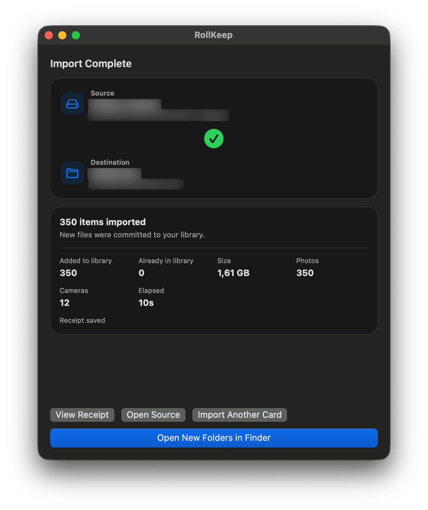

- **Added to library** counts every file that Fyluro added. It includes sidecar files, so it can be more than Photos + Videos + Audio.
- **Already in library** counts files that were already there. Fyluro did not copy them again.
- **Renamed** shows only when it is more than 0. See [Duplicates and renames](#duplicates-and-renames).
- If you import a card again, the headline says **Already in Library**. This is normal.

| Button | What it does |
| --- | --- |
| **Show in Finder** | Opens the new `Photos` and `Videos` folders that this import made. |
| **View Receipt** | Selects the receipt in Finder. |
| **Import Another Card** | Resets the window for the next card. Film Mode turns off. |
| **Source arrow button** | Reveals the source folder in Finder (next to the source name). |

### Import Completed with Warnings

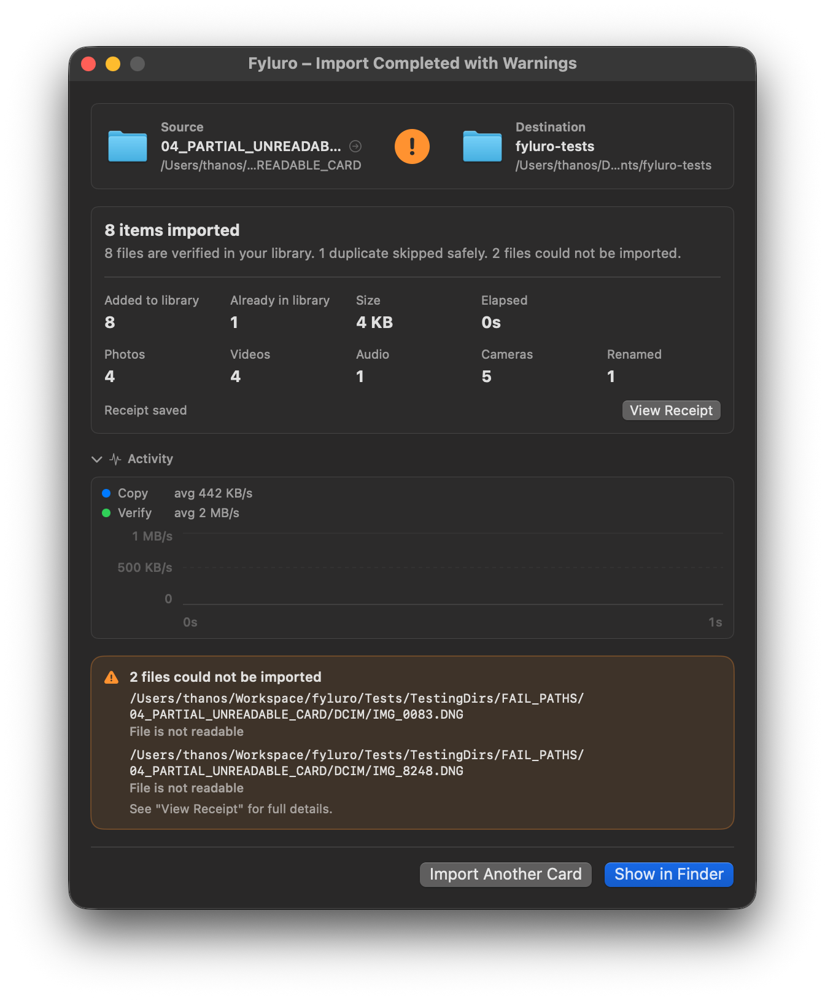

Fyluro shows **Import Completed with Warnings** when valid files entered your library, but some files could not be read or copied.
An orange box (`N files could not be imported`) lists each failed file and its reason.
These files are not in your library. They stay on the card.

### Import Needs Attention and Import Stopped

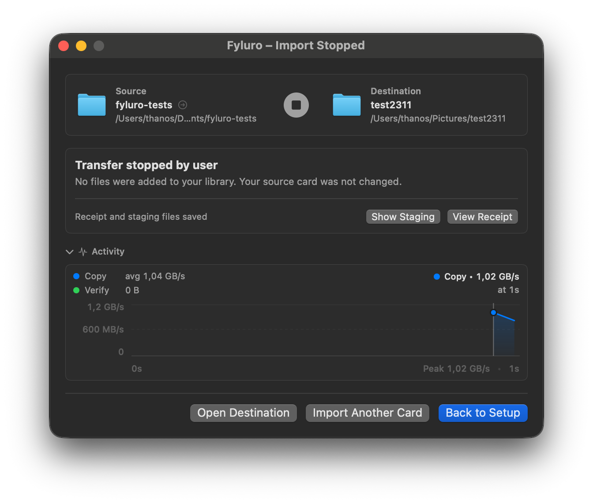

**Import Needs Attention** means that the import did not finish. The message tells you why.
**Import Stopped** shows after you click **Stop Import**. It is not an error.
Both screens have **Show Staging** (shown when a staging folder exists) and **View Receipt** in the summary card.
The bottom bar shows **Open Destination**, **Import Another Card**, and **Back to Setup**.

After a failure or a stop:

- Your card is not changed.
- Files that Fyluro already added to the library stay there.
- Fyluro keeps the receipt and the staging folder `_ingest_staging/<session>` in the destination. It never removes an old one. Delete it in Finder when you no longer need it.

To try again, fix the cause. Click **Back to Setup**, then **Import**.
Fyluro copies and verifies all files again. Files that are already in your library show as **Already in library**.

### The receipt

| Page 1: Summary and inventory | Page 2: Destination folders |
| --- | --- |
| 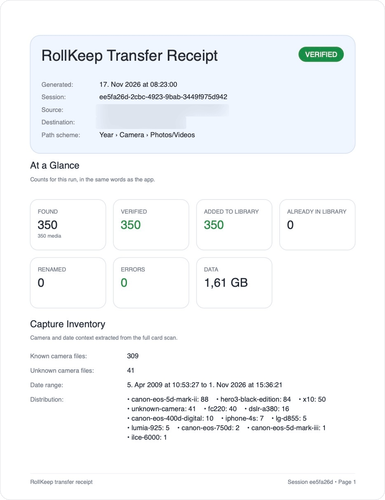 | 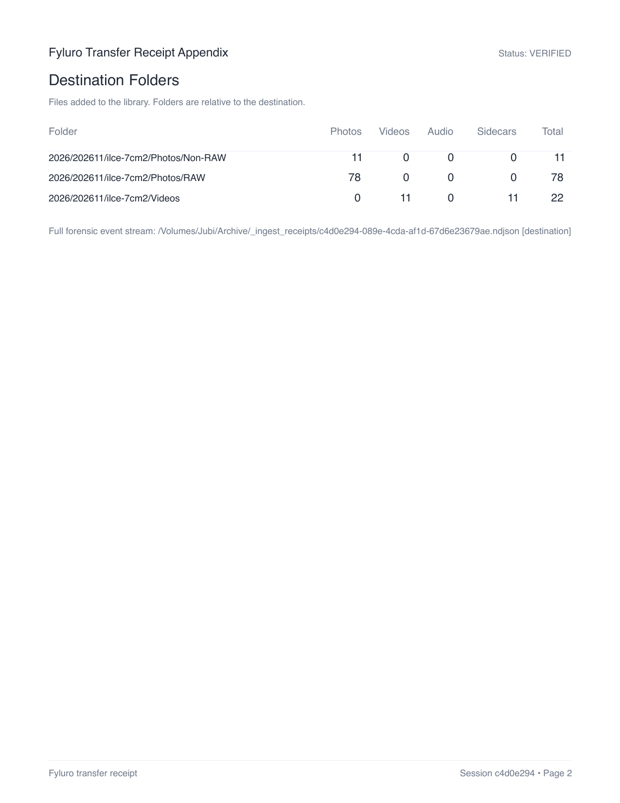 |

Each import writes two files in `_ingest_receipts` in the destination:

- `<session>.summary.pdf` is the summary for people. **View Receipt** selects it.
- `<session>.ndjson` is the full event log, one JSON event on each line.

The PDF shows the status (**VERIFIED** or **FAILED**), the source, the destination and the folder layout.
It also shows:

- The Film Mode record, if you used Film Mode.
- The counts (**At a Glance**) and the errors (**Needs a look**).
- Each renamed file, with its name on the card and its name in the library.
- The camera inventory and the number of files in each library folder.

**VERIFIED** means that every file that Fyluro copied passed verification.
It does not mean that Fyluro copied every file on the card. Fyluro skips some files. Read **Errors** and **Needs a look** to see them.

## 6. Where your files go

The default layout:

```text
<Destination>/
  2026/
    202603/
      iphone-15-pro/
        Photos/IMG_0001.HEIC
        Videos/IMG_0002.MOV
      audio/
        recording.m4a
  _ingest_receipts/
  _ingest_staging/      (only after a failed or stopped import)
```

Audio has no camera folder. You can change the date folders, the camera folder and the `RAW` / `Non-RAW` split in [Settings](#7-settings).

**Camera folders.** Fyluro makes the name from the camera model in the file metadata.
The name has lowercase letters, numbers and dashes only. For example, `iPhone 15 Pro` becomes `iphone-15-pro`.
A file without camera information goes in `unknown-camera`.
Some cameras write a code, for example `ac006`. The folder then has that code. See [Camera Labels](#camera-labels-experimental).

**File names.** Fyluro keeps the file name. A suffix is the only change.

### Duplicates and renames

Fyluro never overwrites a file in your library. When a file with the same folder and name exists:

- **Same content.** The file is a duplicate. Fyluro does not copy it again.
- **Different content.** Fyluro keeps both files. It adds `-1`, `-2` and so on to the new name, before the extension.

Fyluro finds a duplicate only in the folder where the file would go.
If you change the folder layout, Fyluro copies a card that you already imported again, to the new folders.

### Sidecars

A sidecar is a companion file, for example an `.XMP` or a `.THM` file.
Fyluro copies and verifies it with its photo or video, and puts it in the same folder.
A `.WAV` file with the same name as a video in the same folder is a sidecar of that video. Other `.WAV` files are audio.

### Dates

Fyluro reads the capture date in this order:

- **Photos:** the date in the photo metadata, then the modified date of the file on the card.
- **Videos:** the creation date in the video, then the date in a sidecar, then the modified date of the file.
- **Audio:** the creation date in the audio file, then the modified date of the file.

A date without a time zone uses the time zone of your Mac. A wrong camera clock gives a wrong folder date.
Fyluro uses `_unsorted` in place of the year and month only when it finds no date at all. This is rare.

Fyluro keeps the modified date of each file. It keeps the created date when the destination drive allows it.

## 7. Settings

Click **Fyluro** in the menu bar, then **Settings…**. You can also press Command-comma.

### Library

| Setting | Default | What it does |
| --- | --- | --- |
| **Date folders** | `2026/202603` | Other choices are `2026/03` and `2026`. |
| **Group by camera** | On | Puts files in a folder for each camera. |
| **Split photos into RAW / Non-RAW** | Off | Puts photos in a `RAW` folder or a `Non-RAW` folder. |

**Preview** shows sample paths for your choices. Click **Apply** to save them for the next import.
**Reset to Default** sets the options back to the defaults. Click **Apply** to save them.
A running import keeps the settings that it started with.

Choose a layout before your first import, and keep it. Old folders stay as they are when you change it.

### Camera Labels (experimental)

Camera Labels gives a name to a camera code, so the folder reads `osmoaction6` and not `ac006`.
This feature is experimental. It is off by default. Use it at your own risk.

1. Turn on **Use camera labels (experimental)**.
2. In **On the Current Card**, type a name next to a camera code. Press Return.
3. To add a camera that is not on the card, type its code and a name in **Your Labels**. Click **Add**.

- Fyluro saves each name at once. The trash icon removes a label.
- Two codes can have the same name. They then share one folder. Fyluro shows `Same folder as …`.
- A new label applies to the next import. Existing folders stay as they are.
- The app stores labels inside its sandbox container at `~/Library/Containers/com.thanosam.fyluro/Data/Library/Application Support/Fyluro/CameraCatalog.json`.
- When the switch is off, Fyluro ignores the labels. It does not delete them.

### Transfers

The **Transfers** tab controls how many files Fyluro copies at the same time.

| Setting | Default | What it does |
| --- | --- | --- |
| **Destination medium** | Detected automatically | Shows `HDD`, `SSD`, `Unknown`, or `No destination selected`. |
| **Parallel copies** | `1` | Copies `1` or `2` files at the same time. |

When Fyluro detects a spinning hard drive (`HDD`), it locks **Parallel copies** to `1` to prevent slow disk head seeks.
A running import keeps the setting that it started with.

## 8. Film Mode

A scan of film carries the metadata of the device that digitized it.
Film Mode records the camera and the film that you shot on. It also files the photos under the month that you shot them.

1. Click **Film Mode…** in the bottom bar. The **Film Mode** sheet opens.
2. Choose the month, enter the year and enter the camera. Fill in the other fields if you want to.
3. Click **Apply**.

**Month and year shot** (four-digit year, 1826 or later) and **Camera** are required. Enter the camera that exposed the film, not the scanner.
**Apply** stays dimmed until they are valid. The text under the form tells you what is missing.
These fields are optional: **Lens**, **Film stock**, **ISO**, **Shot at**, **Development notes**, **Scanner or camera**, **Creator** and **Copyright**.
Use **Shot at** for a pushed or pulled roll.

After **Apply**, a banner above **Import** shows the record.
For example: `Film Mode — shot on Pentax K1000 · Kodak Gold 200 · Sep 1998`. Click **Edit…** to change it. Click **Turn Off** to turn Film Mode off. **Cancel** on a new roll leaves Film Mode off.
The sheet fills the fields from your last roll. It never fills the month, the year, **Shot at** or **Development notes**.

### What Film Mode changes

- **Folder.** Every photo goes under the month and year that you entered, in a folder for the camera that you entered, for example `1998/199809/pentax-k1000/Photos`.
- **Metadata.** Fyluro writes the date, the camera and your other fields into the library copy of each JPEG, TIFF, HEIC and PNG photo.
- **RAW files.** Fyluro cannot write metadata into RAW files. They keep their metadata and still go in the correct folder. **Import Complete** shows how many RAW files kept it.
- **Photos only.** Videos and audio do not change.
- **Your card.** The files and the file dates on the card do not change.
- **Creator and Copyright.** If you leave them blank, the photo keeps the value from its source file.

Fyluro writes the metadata after it verifies the copy. It does not verify the file again after the write.
For this reason, a second import of the same file is not a duplicate. Fyluro keeps both files, and the new file gets a suffix.

Film Mode applies to every photo in the import. Import one roll at a time.
Film Mode is off when you open Fyluro, and it turns off when you click **Import Another Card**.

## 9. Supported files

Fyluro reads the file type from the end of the file name, without case.

| Kind | File types |
| --- | --- |
| Photos | JPG, JPEG, PNG, TIF, TIFF, HEIC, HEIF, GIF, BMP, JXL |
| RAW photos | DNG, CR2, CR3, CRW, NEF, NRW, ARW, SR2, SRF, ORF, ORI, RAF, RW2, SRW, PEF, X3F, IIQ, GPR, MRW, 3FR, FFF, MOS, MEF, DCR, KDC, K25, ERF, RWL |
| Videos | MOV, MP4, M4V, AVI, MPG, MPEG, MTS, M2TS, MXF, 3GP, 3G2, LRV, MKV, INSV, R3D, BRAW, CRM, ARI, CINE, TS, WEBM |
| Audio | WAV, MP3, M4A, AAC, CAF, AIF, AIFF |
| Sidecars | THM, XMP, AAE, XML, SRT, CPI, NKSC, DOP, PP3, JSON, and WAV next to a video with the same name |

Fyluro imports a sidecar only when it belongs to a photo or a video.

Fyluro skips these items:

- Hidden files and folders (names that start with a dot).
- `System Volume Information`, `$RECYCLE.BIN` and `__MACOSX`.
- Symbolic links. Fyluro never follows them.
- Files of a type that is not in the table.

**Scan Preview** shows a notice for a large file of an unknown type. A large file is 64 MiB or more.
The notice shows only for files in `DCIM`, `PRIVATE`, `AVCHD`, `MP_ROOT`, `MISC`, `MOVIE` or `VIDEO`. It helps you find media from a new camera.

## 10. How Fyluro keeps your files safe

Fyluro follows these rules on every import. No setting turns them off.

1. **Your card does not change.** Fyluro only reads the card. It never writes, renames or deletes a file on it.
2. **Your library is never overwritten.** A new file with the same name gets a suffix.
3. **Every file goes to staging first.** A file enters your library only after it passes verification.
4. **Verification always runs.** You cannot turn it off or skip it.
5. **Your metadata does not change.** Fyluro does not rewrite photo or video metadata. The exception is [Film Mode](#8-film-mode).
6. **A receipt is always written.** If Fyluro cannot write it in the destination, it writes it in a temporary folder on your Mac. If it cannot write it anywhere, the import does not start.
7. **A failed import keeps its evidence.** Fyluro keeps the receipt and the staging folder.
8. **File dates stay.** Fyluro keeps the modified date of each file.
9. **Fyluro writes only in safe places.** It writes the staging folder, the receipts and the new library files in the destination. It writes a receipt in a temporary folder on your Mac only if the destination fails. It deletes only its own staging folder, after a successful import.

Fyluro calculates a SHA-256 hash of each file while it copies the file to staging.
Then it reads the staged file again and compares the hash and the size.
Fyluro copies and verifies all files before the first file moves into your library. One failure stops the import before any file moves.
Fyluro does not read a file again after it moves into your library.

### What verification catches and what it does not

Fyluro bypasses the macOS memory cache, flushes the drive write cache, and reads each staged file back from the destination drive.

- **What this catches:** transfer errors, faulty cables or card readers, controller bugs, and immediate write corruption on bad sectors.
- **What this does not catch:** long-term bitrot. Bitrot is silent data degradation that happens months or years after a valid write (for example, flash charge loss or magnetic decay).

Fyluro checks each file once, during the import. It does not monitor or repair files after the import ends.
Each NDJSON receipt stores the SHA-256 hash of every copied file.
To protect against long-term bitrot, keep backups on more than one drive, or store your archive on a checksumming filesystem such as ZFS.

## 11. Before you erase a card

Fyluro never erases a card. You decide when to do it. Before you erase the card:

1. Look for **Import Complete**. Do not erase the card after **Import Needs Attention** or **Import Stopped**.
2. Look for **Import Completed with Warnings** and the orange box (`N files could not be imported`). Those files are not in your library.
3. Read the notices that **Scan Preview** showed. Fyluro skips unreadable files, symbolic links and large files of an unknown type. These files stay on the card only.
4. Open the receipt. Look for **VERIFIED** and for **Errors** with the count 0.
5. Open a few files in your library and look at them.

## 12. Troubleshooting

**Fyluro does not show my card.** The **Source** row already has another folder selected, or the card has no `DCIM` folder and macOS does not mark it as removable. Click **Change** and choose the card.

**Source must be a readable folder.** Choose the folder again.
If the problem stays, open **System Settings**, then **Privacy & Security**, then **Files & Folders**. Make sure that Fyluro can use removable volumes.

**Destination must be a writable folder.** A drive in the NTFS format is read-only on a Mac. Use APFS or exFAT, or choose another folder.

**Source and destination must be different folders with no nesting.** Choose a destination that is not the source folder and not inside it.

**Not enough free space.** Fyluro needs the size of the media plus a small extra amount.
Free some space, or choose another destination. The red notice under **Destination** has an **Import Anyway** button.
If you click it, the import starts. It stops with an error if the drive becomes full.

**A drive disconnected or became full during the import.** The **Import Needs Attention** screen names the phase and the file.
Connect the drive again, or free some space. Then import again.

**Read-back verification failed: hash mismatch.** The copy is not the same as the original. The receipt shows the file name. Fyluro added no file to your library.
Try a different card reader, cable or port. Then import again. If the problem stays, the card or the file can be damaged.

**Photos are in the wrong month.** Fyluro uses the date in the file, and the camera clock can be wrong. For film scans, use [Film Mode](#8-film-mode).

**Stop Import is slow.** A stop during the first scan waits for the scan to end. A stop during the copy is fast.

<details>
<summary>See examples of setup error banners</summary>

| Unreadable source | Read-only destination |
| --- | --- |
| 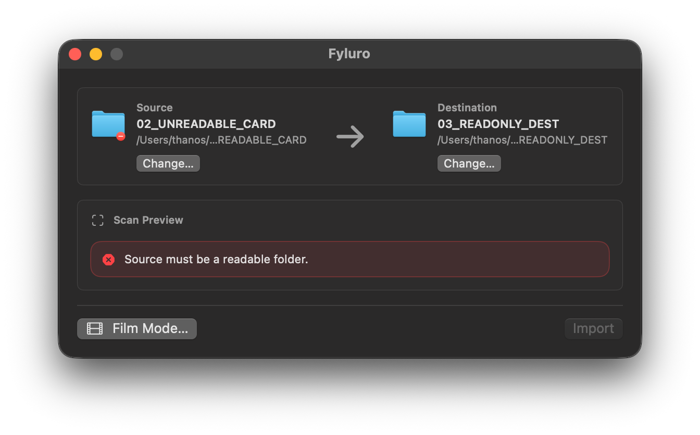 | 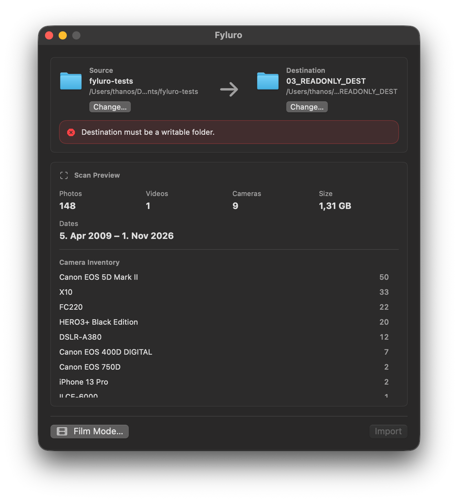 |

| Not enough free space | Nested folders |
| --- | --- |
| 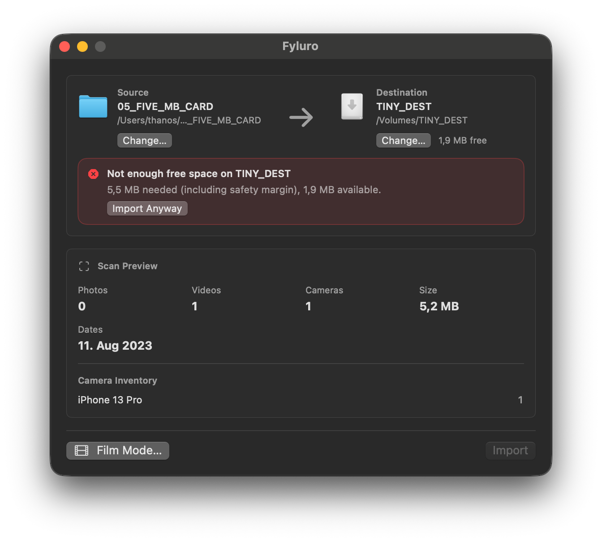 | 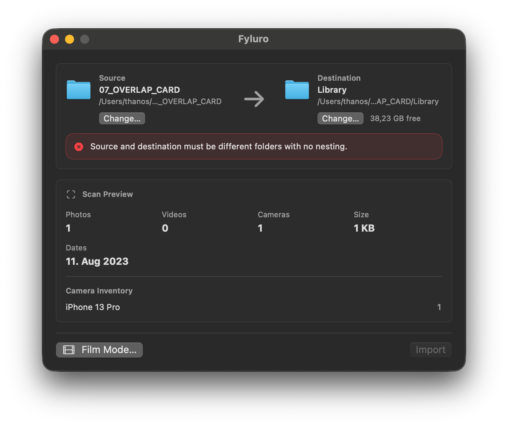 |

</details>
